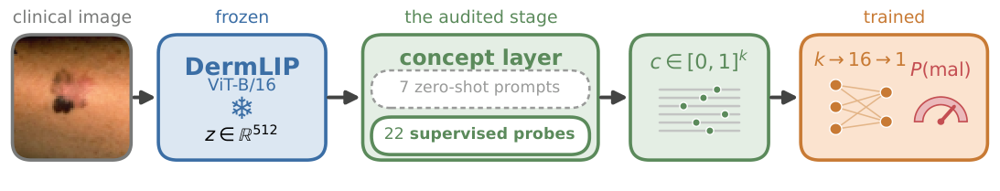
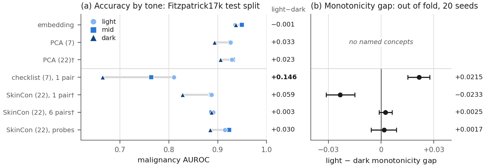
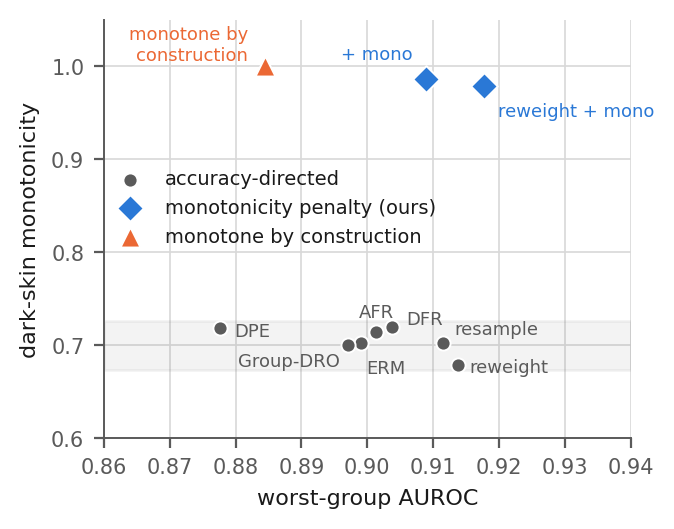

# A Concept Bottleneck Is Only as Faithful as Its Concepts

Code for the ML4H 2026 paper *A Concept Bottleneck Is Only as Faithful as Its Concepts:
Auditing Explanation Faithfulness in Dermatology AI Across Skin Tones* (Shehu, Safiya, Ye and
Qudus, PMLR 346).

A frozen DermLIP encoder feeds a concept layer, which feeds a small malignancy head. The code
measures whether the head uses each concept in its clinical direction (monotonicity), whether
this differs across skin tones, and whether a monotonicity penalty during training corrects it.



## Main results



Zero-shot checklist prompts open a light-dark AUROC gap of 0.146 and a monotonicity gap of
0.0215, although the frozen embedding shows no tone gap. Read with a prompt ensemble or with
supervised probes, the 22 SkinCon concepts reduce the AUROC gap to 0.003 and 0.030, and the
probe layer shows no monotonicity gap. Only the probes detect their concepts reliably (mean
AUROC 0.912 against 0.648). † Analysed post hoc.



On the probe layer, about 30% of concept interventions contradict clinical directions, and
seven accuracy-directed methods leave this proportion largely unchanged. A soft monotonicity
penalty raises monotonicity from 0.70 to 0.98 without lowering worst-group AUROC. A head that
is monotone by construction reaches 1.0 but loses accuracy.

## Setup

Python 3.10. Install the exact package versions used for the paper:

```bash
pip install -r requirements.txt
```

The DermLIP weights ([redlessone/DermLIP_ViT-B-16](https://huggingface.co/redlessone/DermLIP_ViT-B-16))
are downloaded from Hugging Face on first use.

## Data

No data are included. Obtain each dataset from its source and place it as follows:

| Dataset | Source | Place |
|---|---|---|
| Fitzpatrick17k | [github.com/mattgroh/fitzpatrick17k](https://github.com/mattgroh/fitzpatrick17k) | `datasets/`: `fitzpatrick17k.csv` and the images as `fitzpatrick17k.zip` |
| DDI | [ddi-dataset.github.io](https://ddi-dataset.github.io/) (research use agreement) | `datasets/`: the extracted download (`ddi_metadata.csv` and the images) |
| Derm7pt | [derm.cs.sfu.ca](https://derm.cs.sfu.ca/Welcome.html) (registration) | `datasets/`: `meta.csv` and the `images` folder |
| SkinCon | [skincon-dataset.github.io](https://skincon-dataset.github.io/) | `data/`: `annotations_fitzpatrick17k.csv` saved as `skincon_fitz.csv`, `annotations_ddi.csv` saved as `skincon_ddi.csv` |

Files under `datasets/` may sit at any depth. Many Fitzpatrick17k image URLs no longer
resolve; the dataset authors provide the images on request.

## Reproduce

```bash
python encode_features.py   # 1. encode every image once (writes caches/)
python run_pipeline.py      # 2. run the 21 analyses (writes results/)
```

`run_pipeline.py` runs the analyses in dependency order, and each writes one JSON file to
`results/`. Steps whose output already exists are skipped; `--list` shows the plan and
`--force all` recomputes everything. The full run takes several hours on a CPU.

Then print the tables:

```bash
python -m src.reporting.tabulate_methods       # Table 1
python -m src.reporting.tabulate_concepts      # Tables 2 to 6
python -m src.reporting.tabulate_calibration   # Tables 7 and 8
```

Keep the default torch thread count. It sets the floating-point reduction order, and the
monotonicity metric is sensitive to the last digits. Encoding the images again gives
embeddings within about 0.004 of the ones used for the paper, so recomputed numbers can
differ slightly in the last digits.

## Code

| Path | Contents |
|---|---|
| `encode_features.py` | encodes the images with DermLIP and caches the features |
| `run_pipeline.py` | runs the 21 analyses in order; the list of steps is at the top of the file |
| `src/` | concept layer, prompts, head and objectives, metrics, and the DFR, AFR and DPE baselines |
| `src/experiments/` | one analysis per module, each writing one file to `results/` |
| `src/reporting/` | prints the paper's tables from `results/` |

## Citation

```bibtex
@inproceedings{shehu2026concept,
  title     = {A Concept Bottleneck Is Only as Faithful as Its Concepts: Auditing Explanation
               Faithfulness in Dermatology {AI} Across Skin Tones},
  author    = {Shehu, Shuaibu and Safiya, Mohammad and Ye, Wenqian and Qudus, Raheem},
  booktitle = {Proceedings of the Machine Learning for Health Symposium},
  series    = {Proceedings of Machine Learning Research},
  volume    = {346},
  year      = {2026}
}
```

## License

The code is released under the MIT License. The datasets remain under their own terms.
